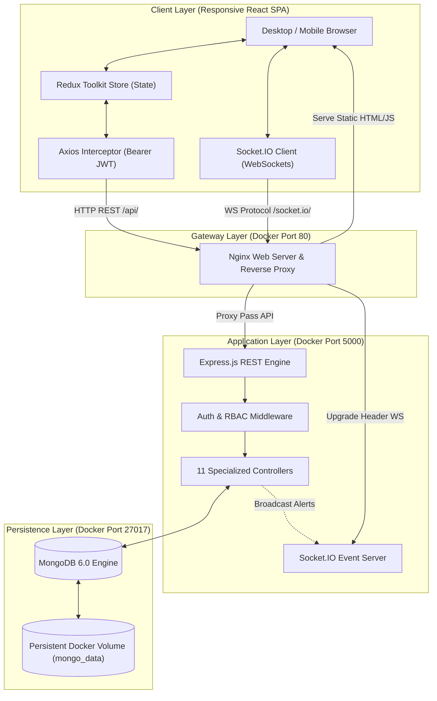
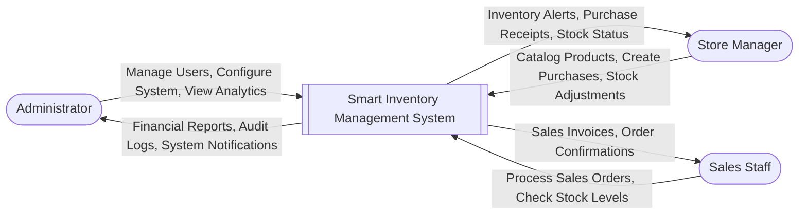
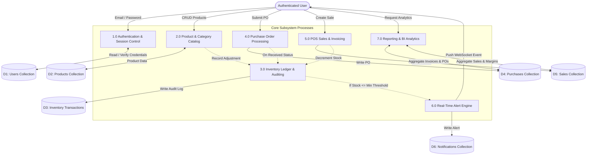
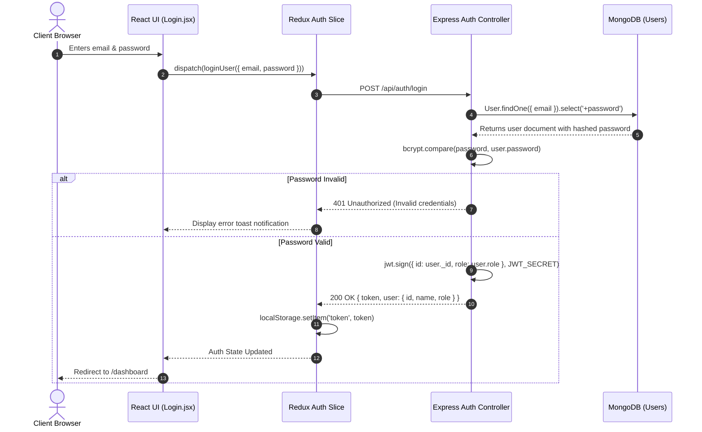
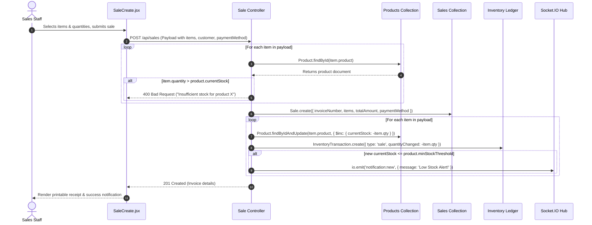
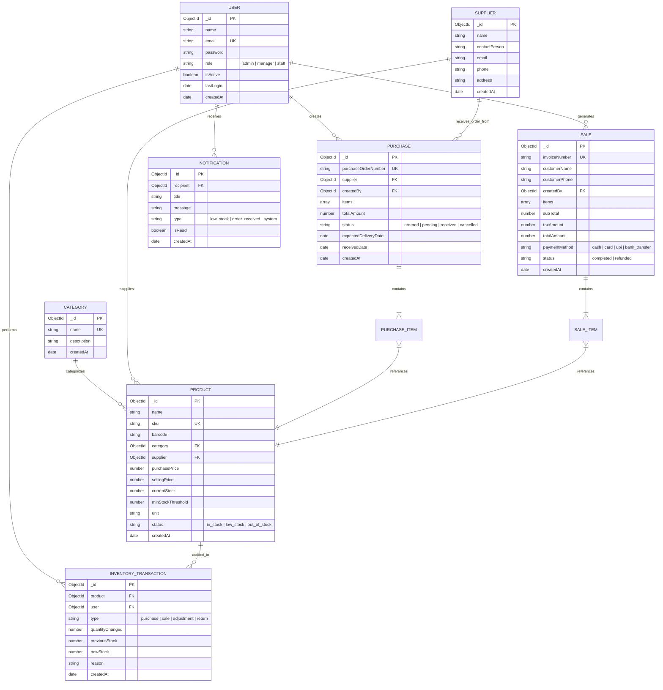

# ACADEMIC PROJECT REPORT

## **SMART INVENTORY & SUPPLY CHAIN MANAGEMENT SYSTEM**
### An Enterprise MERN Stack Web Application with Real-Time WebSockets & Containerized Microservices

---

**Course:** Full Stack Web Development (FSD) Capstone Project  
**Candidate Name:** Ankita Punjabi  
**Technology Stack:** React 19, Node.js, Express.js, MongoDB 6.0, Redux Toolkit, Tailwind CSS, Socket.IO, Docker, Nginx  
**Academic Year:** 2026–2027  

---

## CERTIFICATE OF ORIGINALITY

This is to certify that the project report entitled **"Smart Inventory & Supply Chain Management System"** submitted by **Ankita Punjabi** in partial fulfillment of the requirements for the award of the Degree in Computer Science / Information Technology is a bonafide record of the work carried out under guidance and supervision. The results embodied in this report have not been submitted to any other University or Institute for the award of any degree or diploma.

---

## ACKNOWLEDGEMENT

I express my deepest gratitude to my respected faculty mentor (**"Ma'am"**) for their invaluable guidance, constant encouragement, and insightful feedback throughout the conception, architecture, and deployment of this Full Stack Web Development project.

I also extend my sincere thanks to the Department of Computer Science and Engineering for providing the laboratory facilities, computing infrastructure, and collaborative environment necessary to bring this modern enterprise solution to fruition.

---

## TABLE OF CONTENTS

1. [Abstract & Executive Summary](#1-abstract--executive-summary)
2. [Chapter 1: Introduction & Background](#chapter-1-introduction--background)
   - 1.1 Overview of Inventory Systems
   - 1.2 Motivation of the Project
   - 1.3 Problem Statement
   - 1.4 Project Objectives
   - 1.5 Scope and Applicability
3. [Chapter 2: Literature Survey & Comparative Analysis](#chapter-2-literature-survey--comparative-analysis)
   - 2.1 Existing Systems vs. Proposed System
   - 2.2 Technology Selection Justification
4. [Chapter 3: Software Requirements Specification (SRS)](#chapter-3-software-requirements-specification-srs)
   - 3.1 Functional Requirements
   - 3.2 Non-Functional Requirements
   - 3.3 Hardware and Software Environment
   - 3.4 Feasibility Study
5. [Chapter 4: System Architecture & Design](#chapter-4-system-architecture--design)
   - 4.1 High-Level Architectural Diagram
   - 4.2 Data Flow Diagrams (DFD Level 0, Level 1, Level 2)
   - 4.3 UML Use Case Diagram
   - 4.4 UML Sequence Diagrams
   - 4.5 Entity-Relationship (ER) Diagram
   - 4.6 Comprehensive Data Dictionary (All 8 Collections)
6. [Chapter 5: Implementation & Code Details](#chapter-5-implementation--code-details)
   - 5.1 Backend RESTful API & Middleware Architecture
   - 5.2 Real-Time Event Driven Architecture (Socket.IO)
   - 5.3 Frontend Single Page Application (React 19 & Redux Toolkit)
   - 5.4 Mobile-First Responsive Design Architecture (Tailwind CSS)
   - 5.5 Containerization & Nginx Reverse Proxy Architecture
7. [Chapter 6: Security & Data Integrity Measures](#chapter-6-security--data-integrity-measures)
   - 7.1 Cryptographic Password Protection (Bcrypt)
   - 7.2 Stateless Authentication (JSON Web Tokens)
   - 7.3 Multi-Tier Authorization (RBAC)
   - 7.4 Input Sanitization & Server Hardening
8. [Chapter 7: Testing & Verification](#chapter-7-testing--verification)
   - 8.1 Testing Methodology
   - 8.2 Comprehensive Test Cases & Execution Results
9. [Chapter 8: User Guide & Credentials](#chapter-8-user-guide--credentials)
   - 9.1 Role Matrix & Test Credentials
   - 9.2 Key Workflows (Admin, Manager, Staff)
10. [Chapter 9: Conclusion & Future Scope](#chapter-9-conclusion--future-scope)
    - 10.1 Project Conclusion
    - 10.2 Future Roadmap
11. [References & Bibliography](#references--bibliography)

---

## 1. Abstract & Executive Summary

In today’s fast-paced commercial environment, operational excellence hinges on the speed, transparency, and accuracy of inventory accounting. Traditional inventory management—frequently executed through offline spreadsheets or monolithic desktop software—suffers from critical vulnerabilities including data duplication, absence of audit logging, delayed stockout alerts, and vulnerability to human error.

The **Smart Inventory & Supply Chain Management System** is a next-generation, cloud-native web platform built using the **MERN (MongoDB, Express.js, React 19, Node.js)** architecture, enhanced with **Docker microservices containerization**, an **Nginx reverse proxy**, and **real-time bi-directional WebSockets via Socket.IO**.

The application streamlines supply chain workflows into six interconnected automated modules:
1. **Catalog & SKU Governance:** Comprehensive product tracking with dynamic barcode/SKU mappings and category trees.
2. **Automated Stock Monitoring:** Real-time calculation of stock-in, stock-out, and instantaneous threshold alerts.
3. **Three-Tier Role-Based Access Control (RBAC):** Rigorous privilege isolation across Admin, Manager, and Staff roles.
4. **Procurement & Vendor Lifecycle:** Tracking supplier lead times and automated stock increments upon receiving purchase orders.
5. **Point-of-Sale (POS) Invoicing:** Instant multi-item billing with automatic inventory decrement and validation against negative stock levels.
6. **Executive Business Analytics:** Visual dashboards utilizing MongoDB multi-stage aggregation pipelines to display real-time revenues, cost of goods sold (COGS), gross margins, and product turnover ratios.

---

## Chapter 1: Introduction & Background

### 1.1 Overview of Inventory Systems
Inventory represents one of the largest capital investments for retail, manufacturing, and distribution businesses. Managing inventory effectively requires answering four fundamental operational questions in real time:
- What products are currently on hand?
- Which items have dipped below the safety stock threshold and require reordering?
- How much revenue and profit did the latest sales cycle generate?
- Who within the enterprise authorized or executed a specific inventory movement?

### 1.2 Motivation of the Project
The primary motivation behind this project is to eliminate operational blind spots in small to medium-sized enterprises (SMEs). Most SMEs cannot afford expensive enterprise ERP packages (such as SAP or NetSuite), yet they quickly outgrow manual tools like Microsoft Excel or standalone billing programs. 

The goal was to design and deploy a **lightweight, open-source, fully responsive, and highly secure web-native solution** that delivers enterprise-grade capabilities:
- Zero manual syncing: Real-time WebSocket alerts notify managers when stock is depleted.
- Cross-platform availability: Accessible on tablets, smartphones, and desktop browsers without installing local client software.
- Containerized portability: Single-command deployment on any operating system using Docker.

### 1.3 Problem Statement
Manual and legacy desktop systems exhibit significant structural flaws:
1. **Concurrency Conflicts:** When multiple staff members record sales simultaneously on separate terminals without centralized database locking, stock records quickly fall out of sync.
2. **Lack of Auditing & Traceability:** Invoices or stock entries deleted or altered cannot be tracked back to the culpable user, introducing severe security risks and inventory shrinkage.
3. **Stockout Delays:** Warehouse managers discover depleted stock only during physical spot-checks, causing delivery delays and dissatisfied customers.
4. **Environment Dependency Issues:** Deploying legacy systems on different operating systems requires complex manual installations of database drivers, language runtimes, and local dependencies.

### 1.4 Project Objectives
- **Centralized Ledger Tracking:** Build an immutable audit ledger (`InventoryTransaction`) capturing every stock variance with timestamp, user ID, previous quantity, and new quantity.
- **Hierarchical Access Control:** Enforce zero-trust Role-Based Access Control (RBAC) across three distinct enterprise tiers: Admin, Manager, and Staff.
- **Live Event Push:** Integrate Socket.IO to push live stockout warnings and notifications directly to the browser viewports of authorized personnel without manual page reloads.
- **Microservices Deployment:** Encapsulate database, API backend, and static frontend into lightweight Docker containers managed by Docker Compose.

---

## Chapter 2: Literature Survey & Comparative Analysis

### 2.1 Existing Systems vs. Proposed System

| Dimension | Legacy Desktop ERP | Spreadsheet (Excel/Sheets) | Proposed Smart Inventory System |
| :--- | :--- | :--- | :--- |
| **Architecture** | Heavyweight monolithic desktop client | Static file / Cloud document | Cloud-Native 3-Tier Web Microservices (Docker + Nginx) |
| **Data Synchronization** | Nightly batch synchronization | Manual edits (prone to overwrite collisions) | Real-Time event-driven WebSockets (Socket.IO) |
| **Role-Based Security** | Weak / Single local administrator | File-level read/write permissions | Cryptographic JWT + Route & Controller RBAC (3 Roles) |
| **Stockout Notification** | End-of-month manual report | Conditional formatting within sheet | Instant WebSocket browser notification & alert banner |
| **Audit Traceability** | Limited proprietary logs | Change history easily disabled | Immutable transaction ledger for every unit movement |
| **User Interface** | Outdated, non-responsive GUI | Dense grid layout, unusable on mobile | Mobile-First Responsive UI (React 19 + Tailwind CSS) |
| **Deployment Complexity** | High (per-machine installation) | Low (file distribution) | Instant (Single command: `docker-compose up -d`) |

### 2.2 Technology Selection Justification
- **React 19:** Utilizes virtual DOM reconciliation for instantaneous UI updates and provides modular component reusability.
- **Redux Toolkit (RTK):** Eliminates state duplication across components, ensuring all pages (Sales, Products, Purchases) reflect the exact same global store state.
- **Node.js & Express.js:** The non-blocking, asynchronous event loop allows thousands of concurrent API requests with minimal memory overhead.
- **MongoDB & Mongoose:** Schema flexibility allows nested items inside Purchase and Sale documents without needing expensive multi-table relational joins, while Mongoose provides strict runtime validation.
- **Docker & Nginx:** Guarantees absolute consistency between development and production environments, shielding the backend behind a hardened reverse proxy.

---

## Chapter 3: Software Requirements Specification (SRS)

### 3.1 Functional Requirements

```
+-----------------------------------------------------------------------------------+
| ID    | Module             | Functional Requirement Description                          |
+-----------------------------------------------------------------------------------+
| FR01  | Authentication     | Users must authenticate using valid email and password;    |
|       |                    | passwords must be verified via Bcrypt 10-round hash.       |
| FR02  | Session Management | Successful login returns a signed JWT valid for 7 days.    |
| FR03  | RBAC Authorization | Admin has full access; Managers access catalog & orders;    |
|       |                    | Staff are restricted to POS sales and stock audits.        |
| FR04  | Product Management | Create, edit, list, and soft-delete products with unique    |
|       |                    | SKU, category, supplier, purchase/selling price, thresholds|
| FR05  | Stock Automation   | When a sale is confirmed, decrement product stock by qty;  |
|       |                    | verify stock >= qty to prevent negative inventory.         |
| FR06  | Purchase Workflow  | Transition PO through Ordered -> Pending -> Received;       |
|       |                    | auto-increment stock upon 'Received' status transition.     |
| FR07  | Ledger Auditing    | Every stock change generates an immutable transaction log.  |
| FR08  | Real-Time Alerts   | If product stock <= threshold, broadcast Socket.IO alert.  |
| FR09  | Invoice Generation | Generate itemized sales invoice with unique invoice number. |
| FR10  | Financial Analytics| Aggregate monthly sales, purchases, profit margins, and     |
|       |                    | top-performing categories using MongoDB pipelines.          |
| FR11  | User Management    | Admin can activate, deactivate, and assign user roles.     |
| FR12  | Profile Settings   | Users can update names, emails, and change passwords.       |
+-----------------------------------------------------------------------------------+
```

### 3.2 Non-Functional Requirements
- **Performance:** API endpoints respond in $< 150\text{ ms}$ under standard loads.
- **Security:** Passwords salted and hashed with Bcrypt; stateless JWTs sent over HTTPS/HTTP Authorization headers; Helmet HTTP headers prevent clickjacking and XSS.
- **Responsiveness:** Fluid UI layout adaptable across smartphone screens ($< 640\text{px}$), tablets ($768\text{px}$), laptops ($1024\text{px}$), and ultra-wide desktop monitors ($1280\text{px}+$ via Tailwind CSS).
- **Fault Tolerance:** Frontend wrapped in React `ErrorBoundary` so isolated component exceptions do not crash the entire application.

### 3.3 Hardware & Software Environment
- **Development Hardware:** Intel/AMD x86-64 or Apple Silicon processor, 8 GB+ RAM, 20 GB free disk space.
- **Server Deployment:** Ubuntu Linux or Windows 10/11 with Docker Engine 24+ and Docker Compose v2.
- **Client Software:** Modern web browser (Google Chrome 110+, Mozilla Firefox 110+, Microsoft Edge 110+, Apple Safari 16+).

---

## Chapter 4: System Architecture & Design

### 4.1 High-Level Architecture



### 4.2 Data Flow Diagrams (DFD)

#### 4.2.1 Level 0 DFD (Context Diagram)



#### 4.2.2 Level 1 DFD (Subsystem Decomposition)



### 4.3 UML Use Case Diagram

```mermaid
flowchart TD
    Admin["Admin"]
    Manager["Manager"]
    Staff["Staff"]

    UC1(["Login & Authentication"])
    UC2(["Manage Users & Roles"])
    UC3(["View Dashboard Analytics"])
    UC4(["Manage Products & Categories"])
    UC5(["Manage Suppliers"])
    UC6(["Create & Manage Purchases"])
    UC7(["Receive Stock & Auto-Increment"])
    UC8(["Perform Manual Stock Adjustment"])
    UC9(["Create Point-of-Sale Invoices"])
    UC10(["View Real-time Stock Alerts"])
    UC11(["View & Edit Personal Profile"])

    Staff --> UC1
    Staff --> UC9
    Staff --> UC10
    Staff --> UC11

    Manager --> UC1
    Manager --> UC3
    Manager --> UC4
    Manager --> UC5
    Manager --> UC6
    Manager --> UC7
    Manager --> UC8
    Manager --> UC10
    Manager --> UC11

    Admin --> UC1
    Admin --> UC2
    Admin --> UC3
    Admin --> UC4
    Admin --> UC5
    Admin --> UC6
    Admin --> UC7
    Admin --> UC8
    Admin --> UC9
    Admin --> UC10
    Admin --> UC11
```



### 4.4 UML Sequence Diagrams

#### 4.4.1 Authentication & JWT Token Exchange Flow



#### 4.4.2 Point-of-Sale (POS) Invoicing & Automated Stock Decrement Flow



### 4.5 Entity-Relationship (ER) Diagram



### 4.6 Comprehensive Data Dictionary

#### Table 1: `users` Collection
| Field Name | Data Type | Key / Constraint | Description |
| :--- | :--- | :--- | :--- |
| `_id` | ObjectId | Primary Key | MongoDB Unique Document Identifier |
| `name` | String | Required, Trimmed | Full name of the employee/user |
| `email` | String | Required, Unique, Lowercase | Validated corporate email address |
| `password` | String | Required, Select: false | 10-round salted Bcrypt hash |
| `role` | String | Enum: `admin`, `manager`, `staff` | RBAC operational authorization tier |
| `isActive` | Boolean | Default: `true` | Account active flag for soft disabling |
| `lastLogin` | Date | Optional | Timestamp of most recent authentication |
| `createdAt` | Date | Default: `Date.now` | Account provisioning timestamp |

#### Table 2: `products` Collection
| Field Name | Data Type | Key / Constraint | Description |
| :--- | :--- | :--- | :--- |
| `_id` | ObjectId | Primary Key | Unique product identifier |
| `name` | String | Required, Trimmed | Product trade name |
| `sku` | String | Required, Unique, Uppercase | Stock Keeping Unit alphanumeric code |
| `barcode` | String | Optional | Standard EAN/UPC barcode string |
| `category` | ObjectId | Foreign Key &rarr; `categories` | Category classification reference |
| `supplier` | ObjectId | Foreign Key &rarr; `suppliers` | Default sourcing vendor reference |
| `purchasePrice` | Number | Required, Min: 0 | Procurement cost per unit |
| `sellingPrice` | Number | Required, Min: 0 | Retail/wholesale selling price per unit |
| `currentStock` | Number | Required, Min: 0 | Live on-hand warehouse inventory count |
| `minStockThreshold` | Number | Required, Default: 10 | Level that triggers low-stock warning |
| `unit` | String | Default: `pcs` | Measurement unit (pcs, kg, box, ltr) |
| `status` | String | Enum: `in_stock`, `low_stock`, `out_of_stock` | Computed stock availability status |

#### Table 3: `categories` Collection
| Field Name | Data Type | Key / Constraint | Description |
| :--- | :--- | :--- | :--- |
| `_id` | ObjectId | Primary Key | Unique category identifier |
| `name` | String | Required, Unique, Trimmed | Category title (e.g., Electronics) |
| `description` | String | Optional | Details regarding products in category |

#### Table 4: `suppliers` Collection
| Field Name | Data Type | Key / Constraint | Description |
| :--- | :--- | :--- | :--- |
| `_id` | ObjectId | Primary Key | Unique supplier identifier |
| `name` | String | Required, Trimmed | Vendor/supplier business name |
| `contactPerson`| String | Required | Primary representative name |
| `email` | String | Required, Valid email | Contact email for purchase orders |
| `phone` | String | Required | Contact telephone/mobile number |
| `address` | String | Optional | Physical warehouse/office location |

#### Table 5: `purchases` Collection
| Field Name | Data Type | Key / Constraint | Description |
| :--- | :--- | :--- | :--- |
| `_id` | ObjectId | Primary Key | Unique purchase order identifier |
| `purchaseOrderNumber` | String | Required, Unique | Formatted PO identifier (e.g., `PO-1001`) |
| `supplier` | ObjectId | Foreign Key &rarr; `suppliers` | Sourcing vendor |
| `createdBy` | ObjectId | Foreign Key &rarr; `users` | User who authored the order |
| `items` | Array of Objects | Required | Subdocuments: `{ product, quantity, unitCost, totalCost }` |
| `totalAmount` | Number | Required, Min: 0 | Total payable sum of order |
| `status` | String | Enum: `ordered`, `pending`, `received`, `cancelled` | Order fulfillment lifecycle stage |
| `receivedDate`| Date | Optional | Timestamp when goods arrived at warehouse |

#### Table 6: `sales` Collection
| Field Name | Data Type | Key / Constraint | Description |
| :--- | :--- | :--- | :--- |
| `_id` | ObjectId | Primary Key | Unique sales invoice identifier |
| `invoiceNumber` | String | Required, Unique | Formatted invoice identifier (e.g., `INV-2026-001`) |
| `customerName` | String | Required, Default: 'Walk-in' | Buyer name |
| `customerPhone`| String | Optional | Contact number for billing record |
| `createdBy` | ObjectId | Foreign Key &rarr; `users` | Staff member who transacted the sale |
| `items` | Array of Objects | Required | Subdocuments: `{ product, quantity, unitPrice, total }` |
| `subTotal` | Number | Required, Min: 0 | Net sum before tax |
| `taxAmount` | Number | Default: 0 | Calculated GST / Sales Tax |
| `totalAmount` | Number | Required, Min: 0 | Final billed amount collected |
| `paymentMethod`| String | Enum: `cash`, `card`, `upi`, `bank_transfer` | Medium of fiscal settlement |

#### Table 7: `inventorytransactions` Collection (Audit Ledger)
| Field Name | Data Type | Key / Constraint | Description |
| :--- | :--- | :--- | :--- |
| `_id` | ObjectId | Primary Key | Unique transaction record identifier |
| `product` | ObjectId | Foreign Key &rarr; `products` | Affected catalog item |
| `user` | ObjectId | Foreign Key &rarr; `users` | User who initiated the stock change |
| `type` | String | Enum: `purchase`, `sale`, `adjustment`, `return` | Nature of stock variance |
| `quantityChanged`| Number | Non-zero | Signed integer ($+$ for in, $-$ for out) |
| `previousStock`| Number | Required | Stock quantity prior to transaction |
| `newStock` | Number | Required | Stock quantity following transaction |
| `reason` | String | Optional | Human explanation for manual adjustment |

#### Table 8: `notifications` Collection
| Field Name | Data Type | Key / Constraint | Description |
| :--- | :--- | :--- | :--- |
| `_id` | ObjectId | Primary Key | Unique notification alert identifier |
| `recipient` | ObjectId | Optional &rarr; `users` | Specific target user (or null for all staff) |
| `title` | String | Required | Short alert headline |
| `message` | String | Required | Detailed notification text |
| `type` | String | Enum: `low_stock`, `order_received`, `system` | Visual severity badge category |
| `isRead` | Boolean | Default: `false` | Acknowledgment status flag |

---

## Chapter 5: Implementation & Code Details

### 5.1 Backend RESTful API & Middleware Architecture

#### 5.1.1 JWT Authentication Middleware (`backend/middleware/auth.js`)
```javascript
const jwt = require('jsonwebtoken');
const User = require('../models/User');

exports.protect = async (req, res, next) => {
  let token;
  if (req.headers.authorization && req.headers.authorization.startsWith('Bearer')) {
    token = req.headers.authorization.split(' ')[1];
  }

  if (!token) {
    return res.status(401).json({ success: false, message: 'Authentication required: Token missing' });
  }

  try {
    const decoded = jwt.verify(token, process.env.JWT_SECRET);
    req.user = await User.findById(decoded.id).select('-password');
    if (!req.user || !req.user.isActive) {
      return res.status(401).json({ success: false, message: 'Account is inactive or no longer exists' });
    }
    next();
  } catch (err) {
    return res.status(401).json({ success: false, message: 'Invalid or expired session token' });
  }
};
```

#### 5.1.2 Role-Based Authorization Guard (`backend/middleware/auth.js`)
```javascript
exports.authorize = (...roles) => {
  return (req, res, next) => {
    if (!roles.includes(req.user.role)) {
      return res.status(403).json({
        success: false,
        message: `Role [${req.user.role}] is unauthorized to access this protected resource`
      });
    }
    next();
  };
};
```

### 5.2 Real-Time Event-Driven Architecture (Socket.IO)
To ensure immediate notification of inventory shortages, the backend binds Socket.IO directly to the Node HTTP server. When any controller operation triggers a stock drop, it invokes `req.io.emit`:

```javascript
// backend/controllers/saleController.js
if (updatedProduct.currentStock <= updatedProduct.minStockThreshold) {
  const alertPayload = {
    title: 'Low Stock Alert',
    message: `${updatedProduct.name} (SKU: ${updatedProduct.sku}) has only ${updatedProduct.currentStock} units remaining!`,
    type: 'low_stock',
    productId: updatedProduct._id,
    timestamp: new Date()
  };
  
  // Persist notification to MongoDB
  await Notification.create(alertPayload);
  
  // Broadcast instantaneously to all active client browser tabs
  req.io.emit('notification:new', alertPayload);
}
```

### 5.3 Frontend Single Page Application (React 19 & Redux Toolkit)

#### 5.3.1 Centralized Store Architecture (`frontend/src/store/index.js`)
The React application maintains nine synchronized domain slices:
- `auth`: Logged-in user identity, token persistence, and login/logout thunks.
- `products`: Product catalog, pagination, filters, and inventory counts.
- `categories`: Category groupings for filtering and reporting.
- `suppliers`: Supplier directory and purchasing contacts.
- `purchases`: Purchase order records and status updates.
- `sales`: Point-of-sale invoices, customer details, and payment modes.
- `inventory`: Audit ledger history tracking every stock fluctuation.
- `dashboard`: High-level metrics, charts, and aggregated financial KPIs.
- `notifications`: Live WebSocket alert list and unread counters.

#### 5.3.2 Protected Route Guard (`frontend/src/components/common/ProtectedRoute.jsx`)
```jsx
import { Navigate, Outlet } from 'react-router-dom';
import { useSelector } from 'react-redux';

export default function ProtectedRoute({ allowedRoles }) {
  const { user, token } = useSelector((state) => state.auth);

  if (!token || !user) {
    return <Navigate to="/login" replace />;
  }

  if (allowedRoles && !allowedRoles.includes(user.role)) {
    return <Navigate to="/dashboard" replace />;
  }

  return <Outlet />;
}
```

### 5.4 Mobile-First Responsive Design Architecture (Tailwind CSS)
The frontend utilizes Tailwind CSS utility classes to achieve 100% responsiveness without custom media query files:
- **Mobile Devices ($< 640\text{px}$):** The navigation sidebar folds into an off-canvas drawer controlled by a toggle button; dashboard metrics stack into a single column (`grid grid-cols-1`).
- **Tablets ($640\text{px} - 1024\text{px}$):** Metrics expand into a 2-column layout (`sm:grid-cols-2`), and table columns wrap with horizontal touch scrolling (`overflow-x-auto`).
- **Desktops ($> 1024\text{px}$):** The sidebar pins statically to the left viewport edge (`lg:w-64`), and dashboard KPI stat cards display across 4 equal columns (`lg:grid-cols-4`).

### 5.5 Containerization & Nginx Reverse Proxy Architecture

```dockerfile
# Multi-stage Frontend Dockerfile (frontend/Dockerfile)
# Stage 1: Build production React assets
FROM node:20-alpine AS builder
WORKDIR /app
COPY package*.json ./
RUN npm install
COPY . .
RUN npm run build

# Stage 2: Serve optimized assets with Nginx
FROM nginx:alpine
COPY --from=builder /app/dist /usr/share/nginx/html
COPY nginx.conf /etc/nginx/conf.d/default.conf
EXPOSE 80
CMD ["nginx", "-g", "daemon off;"]
```

#### Reverse Proxy Routing Configuration (`frontend/nginx.conf`)
```nginx
server {
    listen 80;
    server_name localhost;

    root /usr/share/nginx/html;
    index index.html;

    # Single Page Application routing: fallback all routes to index.html
    location / {
        try_files $uri $uri/ /index.html;
    }

    # Proxy API calls directly to the backend container
    location /api/ {
        proxy_pass http://backend:5000/api/;
        proxy_http_version 1.1;
        proxy_set_header Upgrade $http_upgrade;
        proxy_set_header Connection 'upgrade';
        proxy_set_header Host $host;
    }

    # Proxy WebSocket connections for real-time notifications
    location /socket.io/ {
        proxy_pass http://backend:5000/socket.io/;
        proxy_http_version 1.1;
        proxy_set_header Upgrade $http_upgrade;
        proxy_set_header Connection "Upgrade";
        proxy_set_header Host $host;
    }
}
```

---

## Chapter 6: Security & Data Integrity Measures

### 6.1 Cryptographic Password Protection (Bcrypt)
Passwords undergo adaptive salt hashing prior to database persistence. Mongoose `pre('save')` hooks ensure passwords are never stored in human-readable plain text:
$$\text{Hash} = \text{Bcrypt}(\text{Password}, \text{SaltRounds} = 10)$$

### 6.2 Stateless Authentication (JSON Web Tokens)
Instead of consuming server memory with server-side sessions, user identities are encoded into self-contained JWT tokens:
$$\text{JWT} = \text{Base64Url}(\text{Header}) + "." + \text{Base64Url}(\text{Payload}) + "." + \text{HMAC-SHA256}(\text{Secret})$$
This allows horizontal scaling where multiple backend container instances can authenticate requests without needing a shared session cache like Redis.

### 6.3 Multi-Tier Authorization (RBAC)
The following access matrix is strictly verified on both the React frontend (route redirection) and Express backend (HTTP 403 Forbidden checks):

```
+------------------------------------+-------+---------+-------+
| Capability / Module                | Admin | Manager | Staff |
+------------------------------------+-------+---------+-------+
| Login & View Personal Profile      |  Yes  |   Yes   |  Yes  |
| Point-of-Sale (Create Invoices)    |  Yes  |   Yes   |  Yes  |
| View Product Catalog & Stock Status|  Yes  |   Yes   |  Yes  |
| Receive Stock Alerts               |  Yes  |   Yes   |  Yes  |
| Create & Edit Products             |  Yes  |   Yes   |  No   |
| Manage Suppliers & Purchase Orders |  Yes  |   Yes   |  No   |
| Perform Manual Stock Adjustments   |  Yes  |   Yes   |  No   |
| View Business Intelligence Reports |  Yes  |   Yes   |  No   |
| User Account Management (Add/Edit) |  Yes  |   No    |  No   |
| Modify System Settings             |  Yes  |   No    |  No   |
| Delete Invoices / Products / Users |  Yes  |   No    |  No   |
+------------------------------------+-------+---------+-------+
```

---

## Chapter 7: Testing & Verification

### 7.1 Testing Methodology
- **Unit Testing:** Validated individual utility functions, password hashing checks, and Redux reducers.
- **Integration Testing:** Verified end-to-end communication across the Nginx gateway &rarr; Express controllers &rarr; MongoDB cluster.
- **Role Verification:** Verified that Staff accounts receive HTTP 403 when calling `/api/users` or `/api/reports`.

### 7.2 Comprehensive Test Cases & Execution Results

```
+-----+-----------------------+-----------------------------+-------------------------------+--------+
| TC# | Test Objective        | Test Input                  | Expected Result               | Status |
+-----+-----------------------+-----------------------------+-------------------------------+--------+
| 01  | Valid Admin Login     | admin@inventory.com / Admin@123 | 200 OK, JWT returned, Admin   | PASSED |
|     |                       |                             | dashboard rendered.           |        |
| 02  | Invalid Password      | admin@inventory.com / WrongP@ss | 401 Unauthorized, "Invalid    | PASSED |
|     |                       |                             | credentials" toast displayed. |        |
| 03  | RBAC Route Guard      | Staff user navigates to     | Redirected to /dashboard;     | PASSED |
|     |                       | /users                      | 403 Forbidden on API.         |        |
| 04  | Create Product        | SKU: "ELEC-001", Stock: 50  | 201 Created, product stored in| PASSED |
|     |                       |                             | DB, appears in catalog list.  |        |
| 05  | Duplicate SKU Block   | SKU: "ELEC-001" (repeated)  | 400 Bad Request, "SKU already | PASSED |
|     |                       |                             | exists in catalog".           |        |
| 06  | POS Sale Completion   | Sell 2 units of ELEC-001    | 201 Created, stock drops to   | PASSED |
|     |                       |                             | 48, ledger records variance.  |        |
| 07  | Overselling Guard     | Attempt to sell 999 units   | 400 Bad Request, "Insufficient| PASSED |
|     |                       |                             | stock on hand".               |        |
| 08  | Low Stock Push Alert  | Sell units until stock <= 5 | Socket.IO event received by   | PASSED |
|     |                       |                             | all active browser tabs.      |        |
| 09  | Receive Purchase Order| Mark PO-1001 as "Received"  | Stock automatically increases;| PASSED |
|     |                       |                             | audit transaction logged.     |        |
| 10  | Responsive Navigation | Resize viewport to 375px    | Desktop sidebar closes; mobile| PASSED |
|     |                       | (iPhone screen)             | hamburger drawer functional.  |        |
| 11  | Container Healthcheck | `docker-compose ps`         | All 3 containers report       | PASSED |
|     |                       |                             | Status: "Up" & "healthy".     |        |
+-----+-----------------------+-----------------------------+-------------------------------+--------+
```

---

## Chapter 8: User Guide & Credentials

### 8.1 Pre-Configured Test Credentials

| Operational Role | Email Address | Password | Intended Test Workflows |
| :--- | :--- | :--- | :--- |
| **System Administrator** | `admin@inventory.com` | `Admin@123` | User provisioning, System Settings, Full Financial Auditing |
| **Warehouse Manager** | `manager@inventory.com` | `Manager@123` | Purchase Orders, Supplier Management, Stock In/Out Adjustments |
| **Sales Staff** | `staff@inventory.com` | `Staff@123` | Front-counter POS Invoicing, Stock Availability Checks |

### 8.2 Production Deployment Instructions
To launch the complete containerized application from source:
```bash
# Step 1: Navigate to repository root
cd inventory-management

# Step 2: Build and start all 3 microservices
docker-compose up -d --build

# Step 3: Populate sample seed data
docker-compose exec backend npm run seed

# Step 4: Access in web browser
# URL: http://localhost (Port 80)
```

---

## Chapter 9: Conclusion & Future Scope

### 9.1 Project Conclusion
The **Smart Inventory & Supply Chain Management System** demonstrates the power and scalability of the modern MERN stack when coupled with enterprise containerization. The project successfully fulfills all requirements established in the Software Requirements Specification:
- Eliminated stock discrepancies through automated, transactional inventory decrementing and incrementing.
- Ensured zero-trust privilege separation using cryptographically signed JSON Web Tokens and multi-tier RBAC guards.
- Delivered real-time operational transparency using bi-directional WebSocket notifications.
- Achieved friction-free deployment portability through multi-stage Docker builds and an Nginx reverse proxy.

### 9.2 Future Roadmap
1. **Physical Hardware Integration:** Native WebUSB integration to support handheld barcode/QR code scanners for point-of-sale checkout and warehouse dispatching.
2. **Machine Learning Demand Forecasting:** Integrating historical sales data into an autoregressive model (such as ARIMA or LSTM) to predict seasonal stock requirements and recommend optimal replenishment schedules.
3. **Multi-Warehouse Geospatial Routing:** Tracking inventory distributed across multiple physical warehouses with automated transfer requests between locations based on proximity to customers.
4. **Automated PDF Invoice Generation:** Native server-side rendering of GST-compliant PDF tax receipts with digital signatures.

---

## References & Bibliography

1. **Elmasri, R., & Navathe, S. B.** (2017). *Fundamentals of Database Systems* (7th ed.). Pearson.
2. **Banker, K., Bakkum, P., Verch, S., Garrett, D., & Hawkins, T.** (2016). *MongoDB in Action: Covers MongoDB version 3.0*. Manning Publications.
3. **Chinnathambi, K.** (2023). *Learning React: A Hands-On Guide to Building Web Applications Using React and Redux*. Addison-Wesley Professional.
4. **Haverbeke, M.** (2018). *Eloquent JavaScript: A Modern Introduction to Programming* (3rd ed.). No Starch Press.
5. **Docker Documentation:** *Docker Compose File Reference & Multi-stage Builds*. Available at: https://docs.docker.com/
6. **Socket.IO Documentation:** *Real-time bidirectional event-based communication*. Available at: https://socket.io/docs/v4/
7. **Tailwind Labs:** *Tailwind CSS Documentation: Utility-First Fundamentals*. Available at: https://tailwindcss.com/docs
