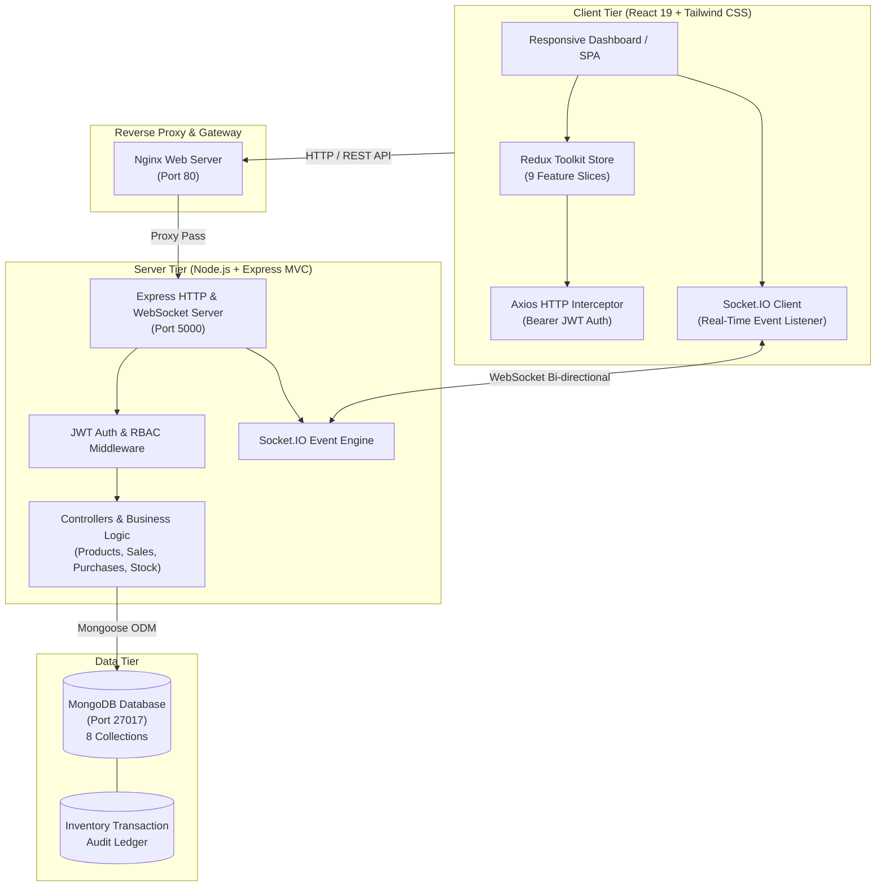

# 📦 Smart Inventory Management System (MERN Stack)

[](https://github.com/your-username/smart-inventory-management/actions/workflows/ci.yml)
[](https://www.docker.com/)
[](https://react.dev/)
[](https://nodejs.org/)
[](https://www.mongodb.com/)
[]()

> A robust, enterprise-grade, web-based Inventory, Procurement, Point of Sale, and Supply Chain Management platform built using the **MERN Stack (MongoDB, Express, React, Node.js)** with **Tailwind CSS**, **Redux Toolkit**, **Socket.IO** real-time events, **Docker Compose**, and **GitHub Actions CI/CD**.

---

## 🎯 1. Project Overview & Objectives

In modern retail and warehouse operations, inventory tracking errors, stockouts, over-purchasing, and delayed synchronization cause severe financial losses. The **Smart Inventory Management System** solves this by providing:

- **Centralized Inventory Monitoring**: Live visibility into product quantities, reorder levels, and asset valuations.
- **Accurate Stock Movement**: Strict tracking of Stock In, Stock Out, and Physical Audit Adjustments with immutable audit logs.
- **Two-Step Procurement Process**: Purchase orders that increment warehouse inventory **only when goods are physically received**, eliminating premature stock inflation.
- **Race-Condition Safe Sales**: Point of sale billing that validates stock availability prior to transaction completion.
- **Instant Real-Time Alerts**: Sub-second Socket.IO broadcasts for low-stock thresholds, out-of-stock warnings, and purchase/sales activities across concurrent browser sessions.
- **Role-Based Access Control (RBAC)**: Secure multi-tier permissions for `Admin`, `Manager`, and `Staff`.

---

## 📋 2. Nine College Faculty Evaluation Requirements Checklist

| # | Requirement | Status | Implementation Details & Key Files | Demonstration Guide |
|---|---|:---:|---|---|
| **A** | **Frontend with Tailwind CSS** | ✅ **100% Done** | Clean navy theme (`#1e3a5f`), responsive sidebar, statistical metric cards, Recharts graphs, modals, data tables, badges (`frontend/src/`) | Show dashboard responsiveness, navigation, dark navy sidebar, and modal interactions. |
| **B** | **React & State Management** | ✅ **100% Done** | React 19, React Router v7, Redux Toolkit (`@reduxjs/toolkit`) with 9 dedicated slices (`auth`, `products`, `categories`, `suppliers`, `inventory`, `purchases`, `sales`, `dashboard`, `notifications`) | Demonstrate Redux state transitions, optimistic updates, and protected route redirection. |
| **C** | **Backend REST API** | ✅ **100% Done** | Express.js MVC architecture with controllers, middleware, input sanitizers, centralized error handling, pagination, and filtering (`backend/controllers/`, `backend/routes/`) | Execute API endpoints via Postman or browser inspect network tab showing 200/201/400/404/409 codes. |
| **D** | **MongoDB & Mongoose** | ✅ **100% Done** | 8 Mongoose Schemas (`User`, `Product`, `Category`, `Supplier`, `Purchase`, `Sale`, `InventoryTransaction`, `Notification`) with indexation, virtual fields, and references (`backend/models/`) | Query MongoDB using mongosh or MongoDB Compass to show populated documents and transactions. |
| **E** | **Data Validation** | ✅ **100% Done** | Dual-tier validation: Frontend constraints + backend `express-validator` rules. Prevents negative prices, duplicate SKUs, invalid ObjectIds, and insufficient stock sales (`backend/validators/`) | Attempt to sell more than available stock or enter a negative price to trigger validation alerts. |
| **F** | **Auth & Authorization** | ✅ **100% Done** | JWT token authentication, bcrypt password hashing (salt rounds = 10), RBAC middleware (`authorize('admin', 'manager')`) (`backend/middleware/auth.js`, `authorize.js`) | Log in as Staff; observe that User Management and admin-restricted actions are forbidden. |
| **G** | **Real-Time via Socket.IO** | ✅ **100% Done** | WebSockets via `socket.io` & `socket.io-client`. Authenticated socket rooms. Events: `stockUpdated`, `lowStockAlert`, `outOfStockAlert`, `newSale`, `newPurchase` (`backend/sockets/`) | Open two browser windows. Make a sale in Window 1; instantly see stock decrement & toast in Window 2 without refreshing! |
| **H** | **Docker Containerization** | ✅ **100% Done** | `backend/Dockerfile`, multi-stage `frontend/Dockerfile` with Nginx reverse proxy, and `docker-compose.yml` orchestrating MongoDB, Backend, and Frontend containers with health checks | Run `docker compose up --build` and access the entire system at `http://localhost`. |
| **I** | **DevOps & CI/CD** | ✅ **100% Done** | GitHub Actions workflow (`.github/workflows/ci.yml`) automating Node.js environment setup, backend syntax verification, Jest tests, and frontend build verification | Demonstrate green build checkmark on GitHub commits and pull requests. |

---

## 🏛️ 3. System Architecture



---

## 🗄️ 4. Database Collections & Schema Models

The system maintains 8 normalized Mongoose models in `backend/models/`:

1. **`User`**: System actors with fields: `name`, `email` (unique index), `password` (bcrypt hashed), `role` (`admin` / `manager` / `staff`), `isActive`, `lastLogin`.
2. **`Product`**: Inventory catalog with fields: `name`, `sku` (unique, uppercase index), `barcode`, `category` (ref Category), `supplier` (ref Supplier), `purchasePrice`, `sellingPrice`, `quantity`, `minStockLevel`, `maxStockLevel`, `unit`, `image`. Virtual fields: `inventoryValue`, `isLowStock`, `isOutOfStock`.
3. **`Category`**: Classification groups with fields: `name` (unique index), `description`, `color`, `icon`, `createdBy`.
4. **`Supplier`**: Procurement vendors with fields: `name`, `companyName`, `email`, `phone`, `address` (nested object), `gstNumber`.
5. **`Purchase`**: Purchase Orders with fields: `purchaseOrderId` (UUID), `supplier` (ref Supplier), `items` array (`product`, `quantity`, `unitPrice`, `totalPrice`), `totalAmount`, `orderStatus` (`pending` / `ordered` / `received` / `cancelled`), `receivedAt`, `receivedBy`.
6. **`Sale`**: Retail and commercial invoices with fields: `saleId` (UUID), `customer` object (`name`, `phone`, `email`), `items` array (`product`, `quantity`, `unitPrice`, `discount`, `totalPrice`), `subtotal`, `discount`, `tax`, `totalAmount`, `paymentMethod`, `paymentStatus`.
7. **`InventoryTransaction`**: Immutable audit trail of every stock change: `product` (ref Product), `transactionType` (`stock_in` / `stock_out` / `adjustment` / `sale` / `purchase`), `quantity`, `previousQuantity`, `newQuantity`, `reference` (`type`, `id`), `reason`, `notes`, `createdBy`.
8. **`Notification`**: System alerts with fields: `title`, `message`, `type` (`low_stock` / `out_of_stock` / `new_sale` / `new_purchase`), `priority`, `isRead`, `relatedTo`.

---

## ⚡ 5. Quick Start & Execution Guide

### Option A: Local Development Setup (Recommended for Development)

#### 1. Prerequisites
- Node.js v18 or v20+
- MongoDB Community Server running locally on `localhost:27017`

#### 2. Backend Setup
```bash
cd inventory-management/backend

# Verify dependencies are ready (already installed)
npm run start
# Or for live-reloading during development:
npm run dev
```
*Backend runs on:* `http://localhost:5000`

#### 3. Database Seeding (Populates Users, Categories, Suppliers, Products)
```bash
cd inventory-management/backend
npm run seed
```

#### 4. Frontend Setup
```bash
cd inventory-management/frontend

# Launch Vite development server
npm run dev
```
*Frontend runs on:* `http://localhost:5173`

---

### Option B: Docker Containerized Setup (Recommended for Faculty Demonstration)

You can run the complete system (MongoDB + Node Backend + React/Nginx Frontend) with a single command:

```bash
cd inventory-management

# Build and start all 3 containers
docker compose up --build
```

Access points:
- **Web Application**: `http://localhost` (Port 80)
- **Backend Health Check**: `http://localhost:5000/api/health`
- **MongoDB Database**: `localhost:27017`

To shut down:
```bash
docker compose down
```

---

## 🔑 6. Pre-Configured Test Credentials

| Role | Email | Password | Permissions & Scope |
|---|---|---|---|
| **System Admin** | `admin@inventory.com` | `Admin@123` | Full privileges: User RBAC management, Product CRUD, Purchasing, Sales, System Reports, Stock Operations |
| **Inventory Manager** | `manager@inventory.com` | `Manager@123` | Operations privileges: Product catalog management, Purchase orders, Receiving goods, Stock In/Out, Reports |
| **Floor Staff** | `staff@inventory.com` | `Staff@123` | Floor operations: Inventory lookup, Point of Sale billing, Sales invoice printing |

---

## 📡 7. Socket.IO Real-Time Event Architecture

The system uses WebSocket events to update all connected clients immediately:

| Socket Event | Triggering Operation | Payload | Frontend Action |
|---|---|---|---|
| `stockUpdated` | Manual Stock In / Stock Out / Adjustment | Product info, new quantity, transaction record | Shows Toast alert; updates product count on screen without refresh |
| `lowStockAlert` | Product quantity falls $\le$ `minStockLevel` | Product name, current quantity, min threshold | Triggers audible/visual warning banner + increments notification badge |
| `outOfStockAlert` | Product quantity hits 0 | Product name, SKU | Displays critical red notification in bell center |
| `newSale` | Completed sale transaction | Sale record, total amount, sold line items | Updates live revenue widget and broadcasts sale notification |
| `newPurchase` | Purchase order marked received | Purchase order ID, supplier name | Confirms warehouse intake and updates stock table |

---

## 🧪 8. Postman API Testing

An official Postman collection file is pre-generated in the project root:
`inventory-management/Smart_Inventory_Postman_Collection.json`

### Steps to Test:
1. Open Postman $\rightarrow$ Click **Import** $\rightarrow$ Select `Smart_Inventory_Postman_Collection.json`.
2. Execute `1. Authentication -> Login (Admin)`.
   - The test script automatically saves the returned JWT token to `{{token}}`.
3. Test any endpoint (`Products`, `Stock In`, `Create Sale`, `Dashboard Stats`, `Reports`) with authenticated authorization headers.

---

## 🎓 9. 15-Minute Faculty Demonstration Script

Follow this step-by-step walkthrough during your project viva/presentation:

### Phase 1: Architecture & Technology Stack (Minutes 0–3)
1. **Explain the Tech Stack**: Explain why MERN + TypeScript + Tailwind was chosen (component modularity, type-safety, rapid utility-first styling).
2. **Show Nine Evaluation Criteria**: Refer to the evaluation checklist table above to demonstrate all faculty criteria are met.
3. **Show Docker & CI/CD**: Point out `docker-compose.yml` and the passing GitHub Actions workflow `.github/workflows/ci.yml`.

### Phase 2: Role-Based Authentication & Security (Minutes 3–6)
1. Navigate to `http://localhost:5173/login`.
2. Log in with **Staff credentials** (`staff@inventory.com` / `Staff@123`).
   - Notice that the **User Management** menu is hidden in the sidebar.
   - Try to navigate to `/users` manually $\rightarrow$ Protected Route instantly redirects back to `/dashboard`.
3. Log out and log in with **Admin credentials** (`admin@inventory.com` / `Admin@123`).
   - The **User Management** section is now accessible.
   - Show how the Admin can modify another user's role between Admin, Manager, and Staff.

### Phase 3: Core Inventory & Business Logic (Minutes 6–10)
1. Go to **Products** $\rightarrow$ Click **Add Product**.
   - Show validation: try submitting negative prices or duplicate SKU $\rightarrow$ proper error alerts appear.
   - Create a product: *Logitech MX Master 3S*, SKU: `MOU-LOGI-001`, Quantity: `10`, Min Level: `5`.
2. Go to **Inventory** $\rightarrow$ **Stock Overview**:
   - Perform a **Stock Out** of 6 units $\rightarrow$ Quantity becomes 4 (below threshold $\le 5$).
   - Notice the badge immediately turns yellow (**Low Stock**).
   - Check the **Transaction History** tab $\rightarrow$ point out the immutable audit record with previous quantity, new quantity, timestamp, and user reference.

### Phase 4: Two-Step Procurement Process (Minutes 10–12)
1. Go to **Purchases** $\rightarrow$ Click **Create Purchase Order**.
   - Create an order for 20 units of *Logitech MX Master 3S* from *TechWorld Distributors*.
   - Check the product stock in Products table $\rightarrow$ notice **stock has NOT increased yet** (Order is still "Pending").
2. Go back to Purchase Order $\rightarrow$ Click **Receive Goods**.
   - Status switches to **Received (In Stock)**.
   - Check product stock $\rightarrow$ quantity has automatically incremented from 4 to 24!
   - Highlight: *"Faculty ma'am, this prevents premature stock inflation before physical delivery."*

### Phase 5: Real-Time Socket.IO Synchronization (Minutes 12–15)
1. Open two browser windows side by side:
   - Window A: Logged in as Admin.
   - Window B: Logged in as Manager/Staff on the **Dashboard** or **Inventory** screen.
2. In Window A, go to **Sales** $\rightarrow$ Click **Create New Sale** $\rightarrow$ Sell 20 units.
3. In Window B:
   - Watch the stock level instantly decrement and the **Low Stock Warning** pop up in real time without refreshing the page!
4. Print the generated Tax Invoice from the sale detail screen.
5. Conclude with the **Reports** page: export the Inventory Valuation and Sales Ledger to CSV.

---

---

## 📚 11. Complete Project Documentation Index

Detailed, standalone student and faculty documentation guides are available in the [`docs/`](./docs/) directory:

1. [**`PROJECT_SETUP_GUIDE.md`**](./docs/PROJECT_SETUP_GUIDE.md) — Step-by-step instructions to run, configure, seed, and troubleshoot on Windows.
2. [**`DATABASE_EXPLANATION.md`**](./docs/DATABASE_EXPLANATION.md) — Deep dive into MongoDB, Mongoose ODM, all 8 models, and relationship diagrams.
3. [**`JWT_AUTHENTICATION_GUIDE.md`**](./docs/JWT_AUTHENTICATION_GUIDE.md) — 10-step authentication sequence, bcrypt hashing, Axios interceptors, and RBAC matrix.
4. [**`API_DOCUMENTATION.md`**](./docs/API_DOCUMENTATION.md) — Complete RESTful API specification across all 11 controller domains.
5. [**`FRONTEND_EXPLANATION.md`**](./docs/FRONTEND_EXPLANATION.md) — React 19 architecture, routing, 9 Redux slices, and UI component breakdown.
6. [**`BACKEND_EXPLANATION.md`**](./docs/BACKEND_EXPLANATION.md) — Node.js, Express MVC architecture, middleware pipeline, and Socket.IO server.
7. [**`DOCKER_GUIDE.md`**](./docs/DOCKER_GUIDE.md) — Multi-stage builds, Nginx reverse proxy, and Docker Compose commands.
8. [**`DEVOPS_GUIDE.md`**](./docs/DEVOPS_GUIDE.md) — GitHub Actions CI/CD pipeline, unit testing, and cloud deployment.
9. [**`VIVA_QUESTIONS.md`**](./docs/VIVA_QUESTIONS.md) — 22 high-probability viva/oral questions and concise, confident answers.
10. [**`FINAL_DEMO_SCRIPT.md`**](./docs/FINAL_DEMO_SCRIPT.md) — Timed 15-minute presentation script and click-by-click live demo walkthrough.

