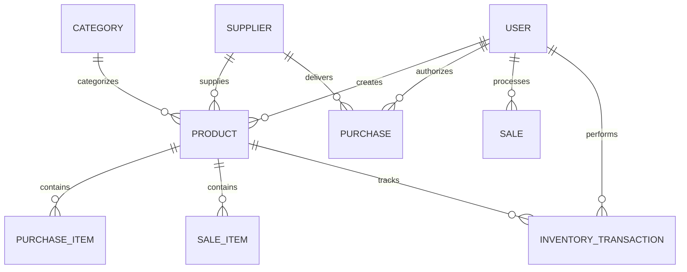

# 🍃 MongoDB & Mongoose Database Architecture Guide

> **Project**: Smart Inventory Management System  
> **Backend Stack**: Node.js + Express.js + Mongoose ODM + MongoDB

---

## 📖 1. Foundational Concepts Explained Simply

### What is MongoDB?
**MongoDB** is a modern, high-performance **NoSQL document database**. Unlike relational databases (like MySQL or Oracle) which store data in strict tables with fixed columns and rows, MongoDB stores records as flexible, JSON-like **BSON documents** (Binary JSON).

### What is Mongoose?
**Mongoose** is an **Object Data Modeling (ODM)** library for MongoDB and Node.js. It acts as an intelligent translator between JavaScript code and the MongoDB database. Without Mongoose, MongoDB accepts arbitrary unstructured data. Mongoose enforces schemas, data types, default values, validations, virtual fields, and relationships.

### Why are we using MongoDB for this project?
1. **Dynamic Inventory Data**: Products have varied attributes (electronics have barcodes, clothing has sizes, groceries have expiration dates). Document models naturally accommodate diverse fields.
2. **Nested Line Items**: Sales invoices and purchase orders have arrays of nested items (`items: [{ product, quantity, unitPrice }]`). In SQL, this requires 3 separate tables and complex multi-table `JOIN` statements. In MongoDB, line items can be modeled directly and populated cleanly.
3. **High Write Throughput**: Fast logging of frequent inventory adjustments, sales dispatches, and warehouse stock-ins.

### MongoDB vs. MySQL Comparison

| Feature | MongoDB (NoSQL) | MySQL (Relational) |
|---|---|---|
| **Data Storage** | JSON-like Documents (BSON) | Tables, Rows & Columns |
| **Schema** | Flexible Schemas governed by Mongoose | Rigid, fixed schema predefined by DDL |
| **Relationships** | References via `ObjectId` + `populate()` | Foreign Keys + SQL `JOIN` queries |
| **Scalability** | Horizontal scaling (sharding) | Vertical scaling (bigger CPU/RAM) |
| **Speed** | Extremely fast read/write for nested data | Excellent for complex ACID transaction graphs |

---

## 🔌 2. How MongoDB Connects in This Project

### Connection Flow
```
[React Frontend] (Axios Request)
       │
       ▼
[Express Backend] (API Route -> Controller)
       │
       ▼
[Mongoose ODM] (Model.find(), Model.create())
       │
       ▼
[MongoDB Engine] (BSON Document Persistence)
```

### Exact Code Implementation:
The connection is established in [backend/config/db.js](file:///C:/Users/ankit/OneDrive/Desktop/FSD_PROJECT/inventory-management/backend/config/db.js):

```javascript
const mongoose = require('mongoose')

const connectDB = async () => {
  if (process.env.NODE_ENV === 'test') {
    return // Skip live connection during isolated tests
  }
  try {
    const conn = await mongoose.connect(
      process.env.MONGODB_URI || 'mongodb://localhost:27017/inventory_db'
    )
    console.log(`MongoDB Connected: ${conn.connection.host}`)
  } catch (error) {
    console.error(`MongoDB connection error: ${error.message}`)
    process.exit(1)
  }
}

module.exports = connectDB
```

And it is invoked at the start of [backend/index.js](file:///C:/Users/ankit/OneDrive/Desktop/FSD_PROJECT/inventory-management/backend/index.js):
```javascript
const connectDB = require('./config/db')
// ...
connectDB()
```

---

## 🗃️ 3. The 8 Mongoose Models Explained in Detail



---

### 1. `User.js` — System Personnel & RBAC
- **Purpose**: Authenticates employees and enforces role permissions (`admin`, `manager`, `staff`).
- **Key Fields**:
  - `name` (String, required): Employee full name.
  - `email` (String, required, unique, lowercase): Login identifier.
  - `password` (String, required, select: false): Encrypted bcrypt hash (never returned in queries).
  - `role` (String, enum: `['admin', 'manager', 'staff']`, default: `'staff'`).
  - `isActive` (Boolean, default: `true`).
  - `lastLogin` (Date).
- **Special Methods**: `comparePassword(candidatePassword)` compares plaintext against stored bcrypt hash.

---

### 2. `Product.js` — Central Inventory Item
- **Purpose**: Stores SKU information, warehouse quantities, safety stock levels, and pricing.
- **Key Fields**:
  - `name` (String, required, indexed): Descriptive title.
  - `sku` (String, required, unique, uppercase, indexed): Stock Keeping Unit.
  - `barcode` (String, optional): EAN/UPC identifier.
  - `category` (`ObjectId`, ref: `'Category'`, required): Product group.
  - `supplier` (`ObjectId`, ref: `'Supplier'`, required): Vendor source.
  - `purchasePrice` (Number, min: 0): Acquisition/cost price.
  - `sellingPrice` (Number, min: 0): Retail/wholesale customer price.
  - `quantity` (Number, min: 0, default: 0): Current warehouse count.
  - `minStockLevel` (Number, min: 0, default: 10): Low-stock warning trigger threshold.
  - `maxStockLevel` (Number, optional): Warehouse capacity ceiling.
  - `unit` (String, default: `'pcs'`): Unit of measurement (`box`, `kg`, `pcs`).
- **Virtuals & Logic**:
  - `inventoryValue`: Dynamically computes `quantity * purchasePrice`.
  - `isLowStock`: Returns `true` if `quantity <= minStockLevel`.
  - `isOutOfStock`: Returns `true` if `quantity === 0`.
  - `pre('save')`: Automatically transforms `sku` to uppercase before saving.

---

### 3. `Category.js` — Product Classification
- **Purpose**: Logical grouping of inventory for filtering, reports, and valuation.
- **Key Fields**:
  - `name` (String, required, unique, trimmed).
  - `description` (String).
  - `color` (String, default: `'#3B82F6'`): Badge color code for UI cards.
  - `icon` (String, default: `'tag'`).
  - `createdBy` (`ObjectId`, ref: `'User'`).
- **Safety Rule**: Deletion is protected in the controller; if any product references this category, the API rejects deletion with an error message.

---

### 4. `Supplier.js` — Procurement Vendors
- **Purpose**: Contact details, tax IDs, and agreements with merchandise vendors.
- **Key Fields**:
  - `name` (String, required): Point of contact name.
  - `companyName` (String, indexed): Corporate identity.
  - `email` (String, required, unique, lowercase): Contact email.
  - `phone` (String).
  - `address` (Object: `street`, `city`, `state`, `pincode`, `country`).
  - `gstNumber` (String, optional): Indian GST/Tax identifier.
  - `isActive` (Boolean, default: `true`).

---

### 5. `Purchase.js` — Vendor Purchase Orders
- **Purpose**: Formal purchase orders for restocking.
- **Key Business Logic**: Creating a purchase order does **NOT** increment inventory. Stock is incremented **only when the order is physically received** (`PATCH /api/purchases/:id/receive`).
- **Key Fields**:
  - `purchaseOrderId` (String, unique): Auto-generated unique order code (e.g. `PO-2026-001`).
  - `supplier` (`ObjectId`, ref: `'Supplier'`, required).
  - `items`: Array of subdocuments:
    - `product` (`ObjectId`, ref: `'Product'`)
    - `quantity` (Number, min: 1)
    - `unitPrice` (Number, min: 0)
    - `totalPrice` (Number)
  - `totalAmount` (Number): Computed grand total.
  - `orderStatus` (String, enum: `['pending', 'ordered', 'received', 'cancelled']`).
  - `receivedAt` (Date), `receivedBy` (`ObjectId`, ref: `'User'`).

---

### 6. `Sale.js` — Point of Sale & Customer Invoices
- **Purpose**: Records sales transactions and outputs printable invoices.
- **Key Business Logic**: Validates warehouse stock before proceeding. Automatically decrements product quantities and creates an `InventoryTransaction` record.
- **Key Fields**:
  - `saleId` (String, unique): Formatted invoice number.
  - `customer`: Subdocument (`name`, `email`, `phone`).
  - `items`: Array of line items (`product`, `quantity`, `unitPrice`, `discount`, `totalPrice`).
  - `subtotal` (Number), `discount` (Number), `tax` (Number), `totalAmount` (Number).
  - `paymentMethod` (enum: `['cash', 'card', 'upi', 'bank_transfer']`).
  - `paymentStatus` (enum: `['paid', 'pending']`).
  - `createdBy` (`ObjectId`, ref: `'User'`).

---

### 7. `InventoryTransaction.js` — The Audit Ledger
- **Purpose**: **Immutable historical log**. Answers: *Who moved what, when, why, and what was the balance change?*
- **Key Fields**:
  - `product` (`ObjectId`, ref: `'Product'`, required, indexed).
  - `transactionType` (enum: `['stock_in', 'stock_out', 'adjustment', 'sale', 'purchase']`).
  - `quantity` (Number): Units moved.
  - `previousQuantity` (Number): Balance before operation.
  - `newQuantity` (Number): Balance after operation.
  - `reference`: Object (`type`: `'Sale'`/`'Purchase'`/`'Manual'`, `id`: `ObjectId`).
  - `reason` (String): Stated justification (e.g. "Physical count reconciliation").
  - `createdBy` (`ObjectId`, ref: `'User'`).

---

### 8. `Notification.js` — In-App Alerts & Warnings
- **Purpose**: Real-time notifications persisted in MongoDB for alerts and audit.
- **Key Fields**:
  - `title` (String), `message` (String).
  - `type` (enum: `['low_stock', 'out_of_stock', 'new_sale', 'new_purchase', 'system']`).
  - `priority` (enum: `['low', 'medium', 'high']`).
  - `isRead` (Boolean, default: `false`).
  - `relatedTo`: Dynamic ref (`model`: String, `id`: `ObjectId`).

---

## 🔍 4. Key MongoDB Terms Defined Simply

- **Schema**: The blueprint/rulebook defining field names, types, and constraints (e.g., `new mongoose.Schema({ name: String })`).
- **Model**: The compiled JavaScript class wrapped around a schema that provides querying methods like `Product.find()`, `Product.create()`.
- **Collection**: A grouping of MongoDB documents (equivalent to a SQL table). Example: `products`, `users`.
- **Document**: A single record inside a collection (equivalent to a SQL row).
- **ObjectId**: A unique 12-byte (24-hex-character) identifier auto-generated for every MongoDB document (e.g. `65f1a2b3c4d5e6f7a8b9c0d1`).
- **`populate()`**: Mongoose's equivalent of a SQL `JOIN`. It replaces an `ObjectId` reference with the full document from another collection. Example:
  ```javascript
  const product = await Product.findById(id).populate('category', 'name color')
  // Now product.category is an object { _id: '...', name: 'Electronics', color: '#3B82F6' }
  ```
- **Indexing**: A data structure (B-tree) built on specific fields (like `email` or `sku`) allowing MongoDB to locate documents in $O(\log N)$ time without scanning every record.
- **Timestamps**: Setting `{ timestamps: true }` in Mongoose automatically adds and manages `createdAt` and `updatedAt` Date fields.
