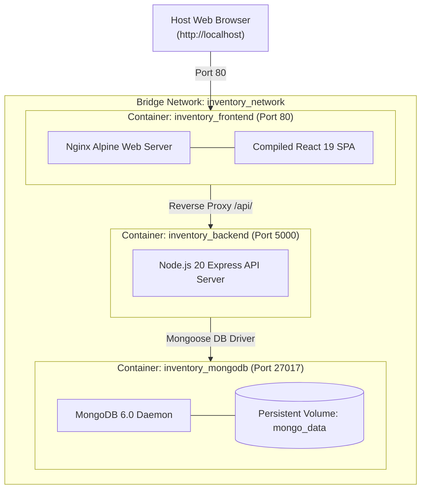

# 🐳 Docker & Docker Compose Containerization Guide

> **Project**: Smart Inventory Management System  
> **Container Stack**: MongoDB 6.0 + Node.js 20 Backend + React 19 Nginx Frontend

---

## 💡 1. Docker Concepts Explained Simply

- **Docker**: A containerization platform that bundles an application and all its dependencies (Node.js runtime, OS libraries, Nginx, config) into an isolated unit called a container. It solves the *"It works on my machine, but not on the server"* problem.
- **Image**: A read-only template or snapshot containing instructions to build a container (like a blueprint or class).
- **Container**: A running, executable instance of an image (like an object created from a class).
- **Dockerfile**: A text file containing sequential commands to assemble a Docker image.
- **Docker Compose**: A tool for defining and running multi-container Docker applications using a single `docker-compose.yml` file.
- **Volume**: Persistent storage managed by Docker outside the container filesystem. If a MongoDB container is stopped or deleted, data stored in a volume remains completely safe.
- **Port Mapping (`host:container`)**: Connects an outside machine port to an internal container port (e.g. `5000:5000` maps your PC's port 5000 to the container's port 5000).
- **Health Check**: An automated ping checking whether the internal service is ready to accept traffic before starting dependent services.

---

## 📦 2. Docker Architecture in This Project



---

## 📄 3. Detailed Inspection of Docker Configuration Files

### A. Backend Dockerfile ([backend/Dockerfile](file:///C:/Users/ankit/OneDrive/Desktop/FSD_PROJECT/inventory-management/backend/Dockerfile))
```dockerfile
FROM node:20-alpine
WORKDIR /app
COPY package*.json ./
RUN npm ci --only=production
COPY . .
RUN mkdir -p uploads
EXPOSE 5000
ENV NODE_ENV=production
ENV PORT=5000
CMD ["node", "index.js"]
```
- **Base image**: `node:20-alpine` (ultra-lightweight Linux distribution, only ~50MB).
- **Optimization**: Copies `package.json` first and runs `npm ci` so dependency layers are cached unless `package.json` changes.

---

### B. Frontend Multi-Stage Dockerfile ([frontend/Dockerfile](file:///C:/Users/ankit/OneDrive/Desktop/FSD_PROJECT/inventory-management/frontend/Dockerfile))
```dockerfile
# Stage 1: Build the React Application
FROM node:20-alpine AS builder
WORKDIR /app
COPY package*.json ./
RUN npm ci
COPY . .
RUN npm run build

# Stage 2: Serve via Nginx
FROM nginx:alpine
COPY --from=builder /app/dist /usr/share/nginx/html
COPY nginx.conf /etc/nginx/conf.d/default.conf
EXPOSE 80
CMD ["nginx", "-g", "daemon off;"]
```

> 🌟 **Why Multi-Stage Build?**  
> Notice Stage 1 has all the Node.js tools, TypeScript compiler, and `node_modules` (~400MB).  
> Stage 2 only copies the compiled static HTML/CSS/JS (`dist/`) into Nginx (~25MB).  
> **Result**: The final container image is ultra-small, lightning-fast to deploy, and highly secure with zero Node runtime vulnerabilities.

---

### C. Nginx Reverse Proxy Config ([frontend/nginx.conf](file:///C:/Users/ankit/OneDrive/Desktop/FSD_PROJECT/inventory-management/frontend/nginx.conf))
```nginx
server {
    listen 80;
    root /usr/share/nginx/html;
    index index.html;

    # Support React Router single page app routing
    location / {
        try_files $uri $uri/ /index.html;
    }

    # Proxy API calls directly to the backend container
    location /api/ {
        proxy_pass http://backend:5000/api/;
        proxy_http_version 1.1;
        proxy_set_header Host $host;
    }

    # Proxy WebSocket connections for Socket.IO
    location /socket.io/ {
        proxy_pass http://backend:5000/socket.io/;
        proxy_http_version 1.1;
        proxy_set_header Upgrade $http_upgrade;
        proxy_set_header Connection "Upgrade";
    }
}
```

---

### D. Docker Compose File ([docker-compose.yml](file:///C:/Users/ankit/OneDrive/Desktop/FSD_PROJECT/inventory-management/docker-compose.yml))
Orchestrates all 3 containers on a private bridge network:
1. **`mongodb`**: Boots MongoDB 6.0 with persistent disk volume `mongo_data` and healthcheck ping.
2. **`backend`**: Waits for MongoDB healthcheck to report healthy, then starts the Express API.
3. **`frontend`**: Waits for Backend, then serves on Port 80.

---

## 🛠️ 4. Exact Commands to Run & Manage Docker

Run all commands from: `C:\Users\ankit\OneDrive\Desktop\FSD_PROJECT\inventory-management`

### 1. Build and Start All Containers
```powershell
docker compose up --build
```
- Add `-d` to run in the background (detached mode):
  ```powershell
  docker compose up -d --build
  ```

### 2. View Status of Containers
```powershell
docker compose ps
```
- **Expected Output**: Shows 3 containers (`inventory_mongodb`, `inventory_backend`, `inventory_frontend`) with state `Up`.

### 3. View Live Logs
```powershell
docker compose logs -f
# Or view backend logs only:
docker compose logs -f backend
```

### 4. Stop All Containers
```powershell
docker compose down
```

### 5. Stop and Wipe Database Volume (Fresh Start)
```powershell
docker compose down -v
```
